<p align="center">
  <picture>
    <source media="(prefers-color-scheme: light)" srcset="assets/logo-dark.png">
    
  </picture>
</p>

<h1 align="center">Omatravel</h1>

<p align="center">Your trips on a spinning globe, one click away in the <a href="https://omarchy.org">Omarchy</a> bar.</p>

<p align="center">
  <a href="https://github.com/qempexe/omarchy-omatravel/releases"></a>
  <a href="LICENSE"></a>
  <a href="https://omarchy.org"></a>
</p>

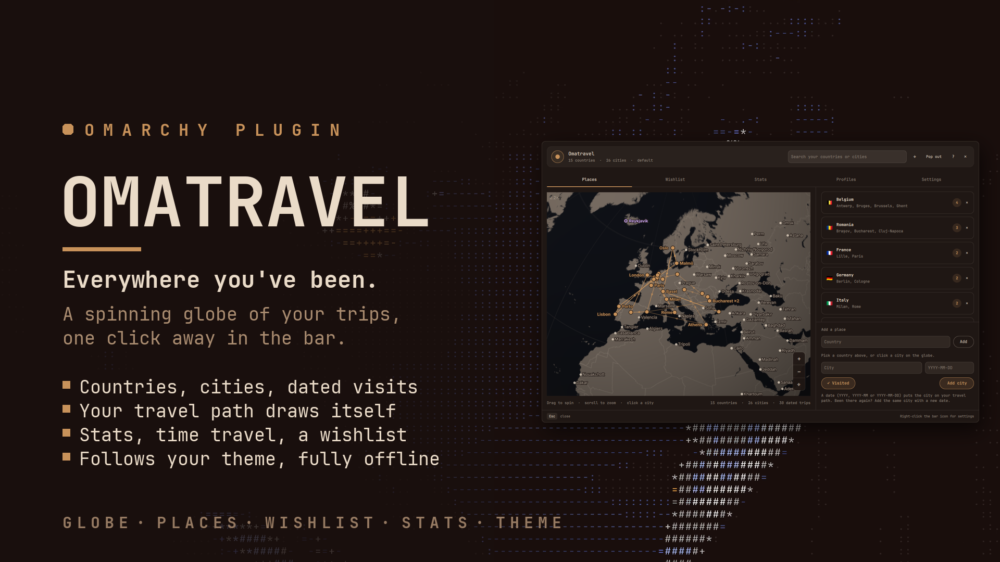

I like looking back at where I've been, but every travel app wanted an account,
a subscription or my location. So I made a small atlas that lives in the bar,
works offline and keeps everything in one file on my machine. Click the 🌍,
spin the world, add a city.

## Features

- **Places**: countries, cities and dated visits, with your travel path drawn
  between them in the order you went.
- **Wishlist**: the places you still want to see, pinned in a second color.
- **Stats and time travel**: countries, continents, distance travelled, your
  busiest year, and the globe as it was at the end of any year.
- **Profiles**: separate maps for you, the family, or the road trip you keep planning.
- **A fast globe**: a GPU shaded sphere with city labels that load as you zoom,
  down to places with 1,000 people, smooth at every zoom level.
- **Follows your theme**: it repaints the moment you switch your Omarchy theme,
  and its outline can run through your window border's gradient.
- **Docked or popped out**: a panel under the bar, or its own window.
- **Offline and private**: no account, no network, your data in one file only you can read.

### Places

The globe on the left, your countries on the right. Every dated visit is linked
to the next one with a great-circle arc, so the lines are the actual order you
travelled in. This is my Europe:

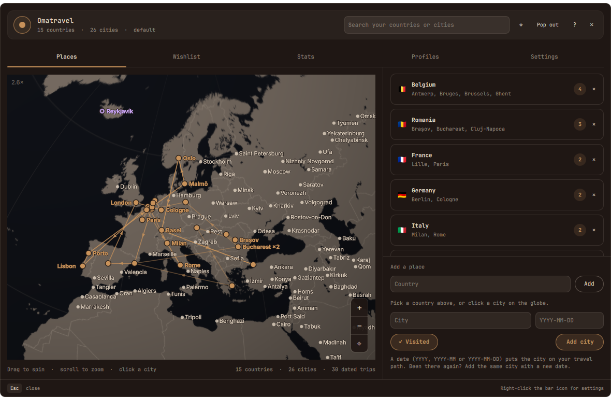

Zoom in and more cities get labels, from the big ones down to places with 1,000
people. Click any of them and it's filled into the add form for you.

Rather have the globe on the right? **Globe side** in the settings swaps the two.

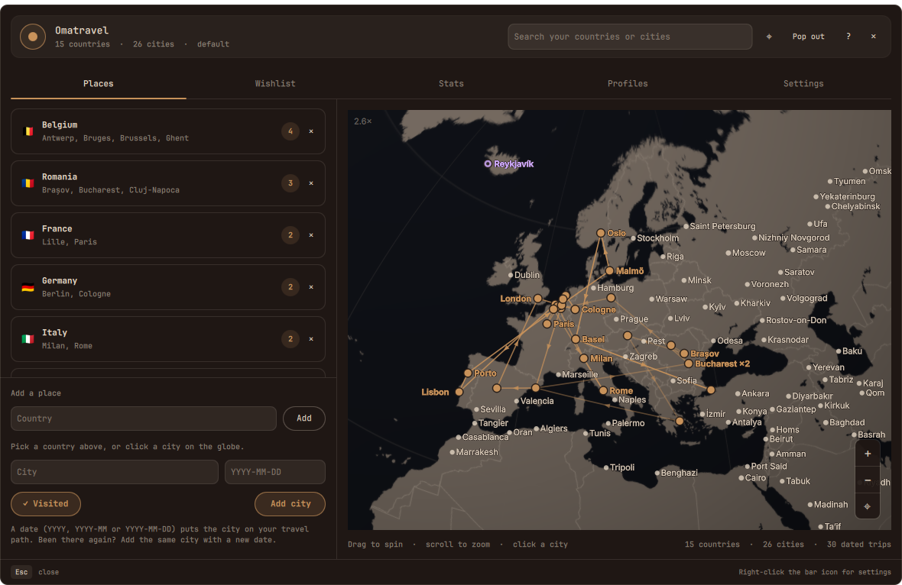

### Wishlist

The places you still want to see, pinned in a second color. Once you've been,
press **✓** and the city moves over to your visited places.

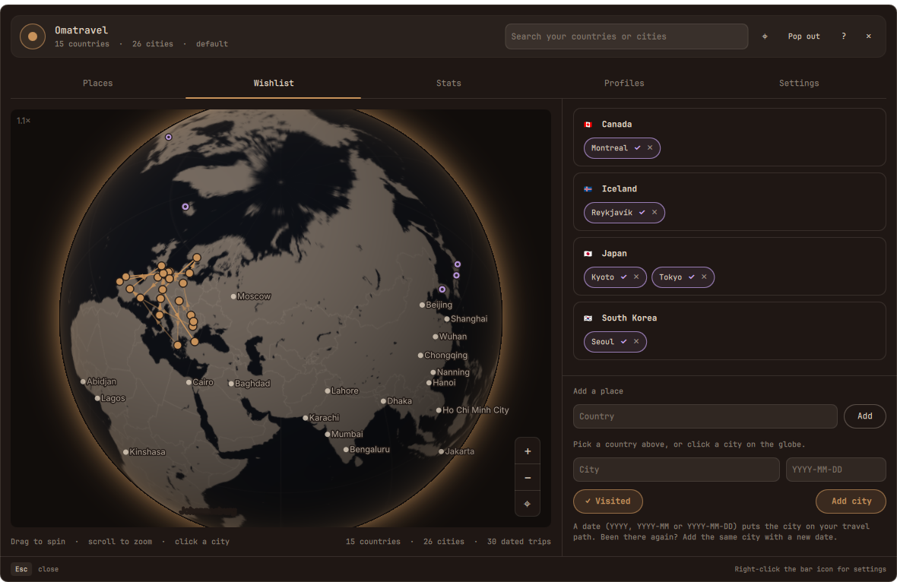

### Stats and time travel

How many countries (and how much of the 195 that is), continents, cities and
visits, how far you've travelled in km and in laps around the Earth, your first
and latest trip, most visited city and busiest year.

Underneath is the fun bit: pick a year and the globe goes back to how your map
looked at the end of it.

<table>
<tr>
<td>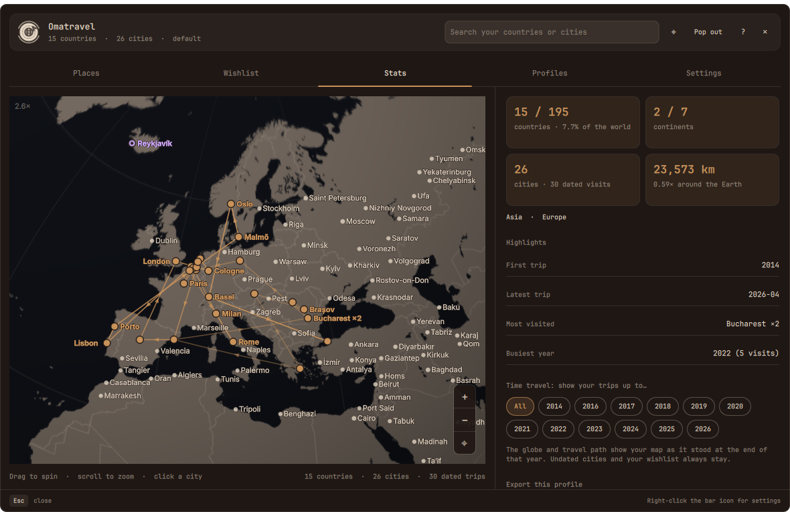</td>
<td>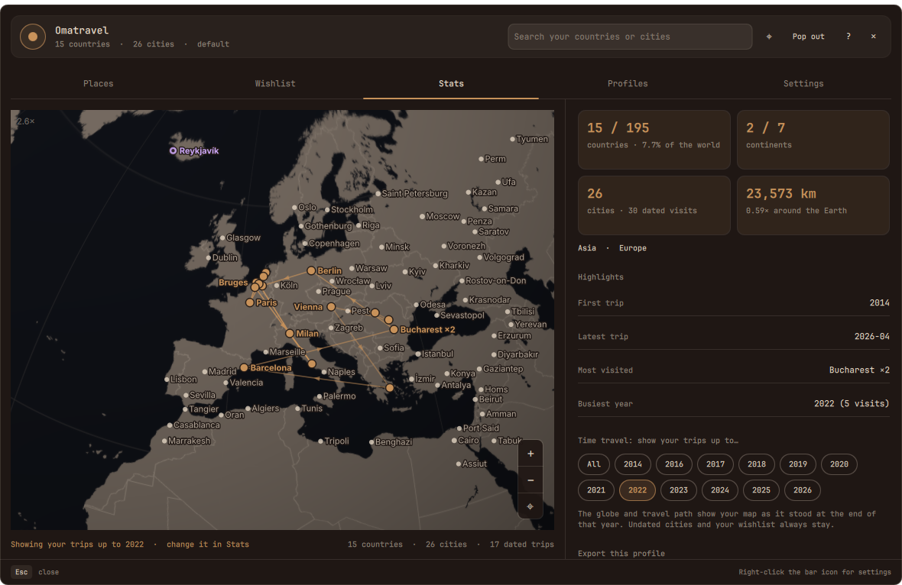</td>
</tr>
<tr>
<td align="center"><sub>everything</sub></td>
<td align="center"><sub>back to the end of 2022</sub></td>
</tr>
</table>

From here you can also export the active profile, as **CSV** for a spreadsheet
or as **JSON**.

### Profiles

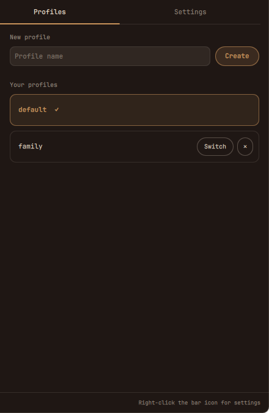

Separate maps with their own places and wishlist: one for you, one for family
trips, one for that road trip you keep planning. Switch whenever you like. The
`default` profile is the one that can't be deleted.

The header also has a search box for your countries and cities, **Pop out** to
move the whole atlas into its own window (handy on a second monitor), and **?**
for the cheat sheet below.

<br clear="right">

### Themes

Out of the box it follows your Omarchy theme and repaints the moment you switch.
There are ten built-in themes too (`catppuccin`, `dracula`, `everforest`,
`gruvbox`, `kanagawa`, `mono`, `nord`, `omarchy`, `rose-pine`, `tokyo-night`), or
**Custom** with your own background, text and accent. The screenshots above use a
custom brown one. Tokyo Night, Gruvbox, Catppuccin and Rosé Pine:

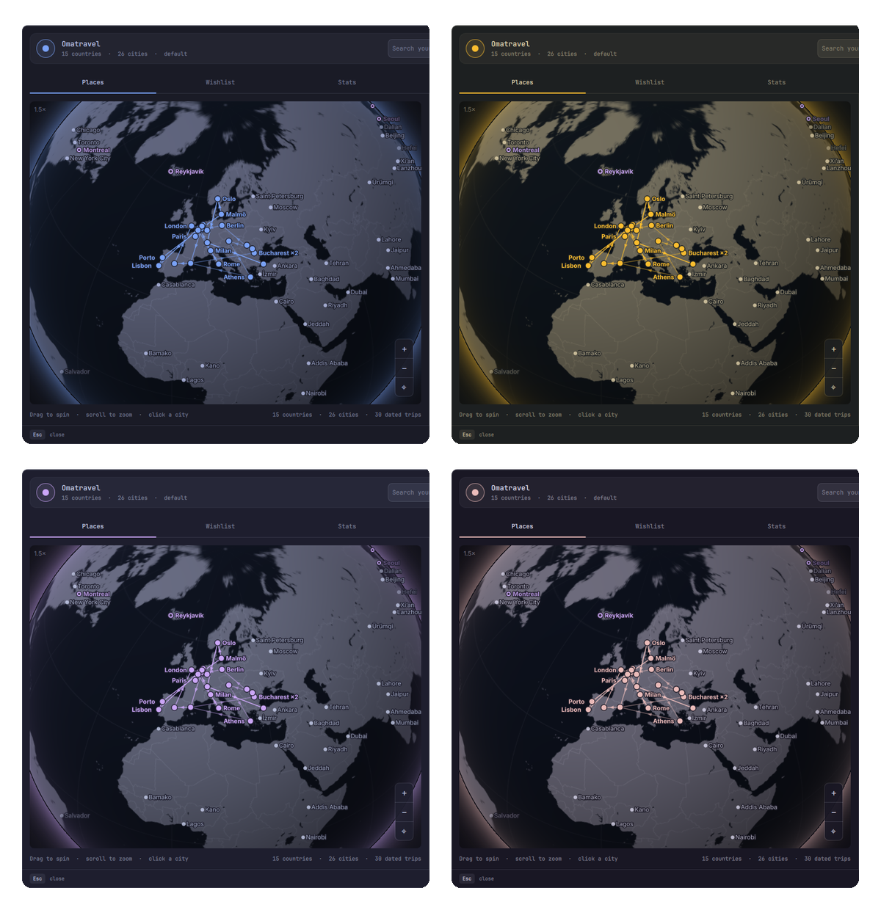

## Installation

```bash
omarchy plugin add https://github.com/qempexe/omarchy-omatravel.git --enable --yes
omarchy restart shell
```

Then put **Omatravel** in your bar, from the bar settings or with
`{ "id": "io.github.qempexe.omatravel" }` under `bar` → `layout` in
`~/.config/omarchy/shell.json`.

Nothing else is needed: the globe texture, the shaders and the city data come
prebuilt with the plugin.

## Usage

### Your first trip, in a minute

1. Click the globe icon in the bar.
2. Type `Spain` in **Country** and press **Add**.
3. Type `Barcelona`, a date like `2024-06`, and press **Add city**. It gets a pin.
4. Add another city with a date. An arc appears between the two, pointing the way
   you went.

Dates can be as rough as you remember them: `2019`, `2019-05` or `2019-05-02`.
Went back? Add the same city with a new date and it becomes `Barcelona ×2`.

### Controls

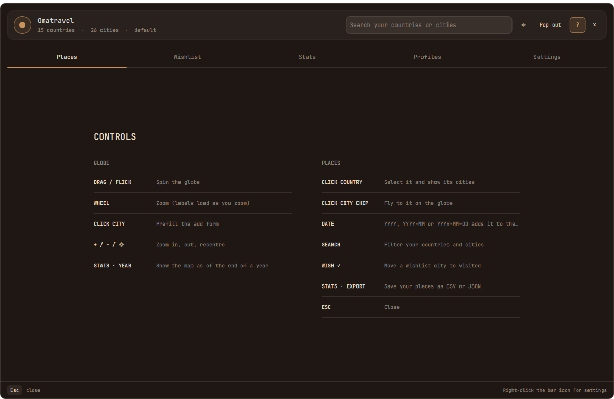

| | |
| --- | --- |
| Spin / zoom | drag or flick, scroll or **+ −**, **⌖** recenters |
| Fly to a city | click its chip in Places |
| Remove something | the **✕** next to it (a country, a city or one visit) |
| Visited or wishlist | the switch at the bottom of the add form |
| Pop out / back | **Pop out**, then the bar icon shows and hides the window until you press **Dock** |
| Settings | right click the bar icon |
| Close | `Esc` |

## Configuration

Everything is in the **Settings** tab (right click the bar icon to jump there),
in four tabs plus **About**. Changes apply right away. On the Settings tab the
header's search box searches the settings instead of your places, **Changed only**
lists what differs from the defaults, anything you've changed gets a ↺, and
**Reset all** (click twice) puts it all back. Settings that do nothing with your
current choices are dimmed. Your places are never touched by any of it.

The same keys also work in the widget's entry in `~/.config/omarchy/shell.json`;
whatever you change in the panel wins over them. Panel changes are saved in
`~/.local/state/omarchy-omatravel/settings.json`.

<details>
<summary><b>Bar</b>: icon, counts, clicks, tooltip</summary>
<br>
<p align="center">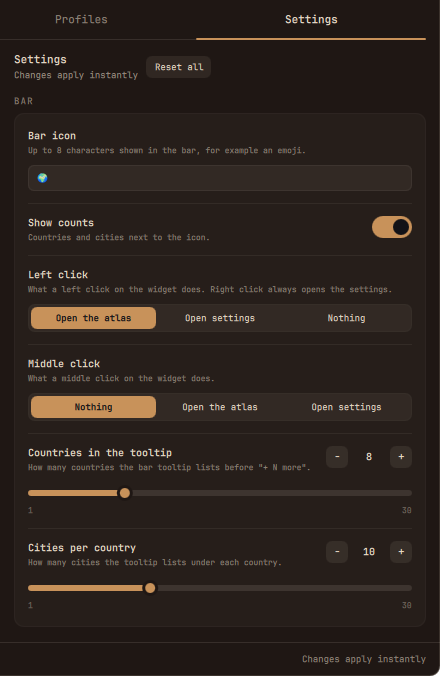</p>

| Setting | Key | Values | Default |
| --- | --- | --- | --- |
| Bar icon | `icon` | up to 8 characters | 🌍 |
| Show counts | `showCounts` | on / off | on |
| Left click | `clickAction` | `panel`, `settings`, `none` | `panel` |
| Middle click | `middleAction` | `none`, `panel`, `settings` | `none` |
| Countries in the tooltip | `maxTooltipCountries` | 1 to 30 | 8 |
| Cities per country | `maxTooltipCities` | 1 to 30 | 10 |

Right click always opens the settings.
</details>

<details>
<summary><b>Globe</b>: side, flags, path, labels</summary>
<br>
<p align="center">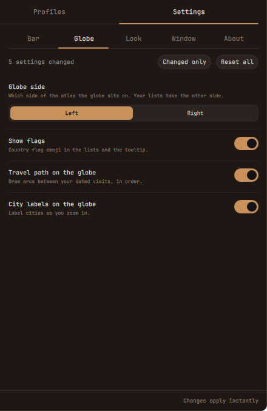</p>

| Setting | Key | Values | Default |
| --- | --- | --- | --- |
| Globe side | `globeSide` | `left`, `right` | `left` |
| Show flags | `showFlags` | on / off | on |
| Travel path on the globe | `showPath` | on / off | on |
| City labels on the globe | `showPlaces` | on / off | on |
</details>

<details>
<summary><b>Look</b>: theme, colors, opacity, roundness, outline, text size</summary>
<br>
<p align="center">
  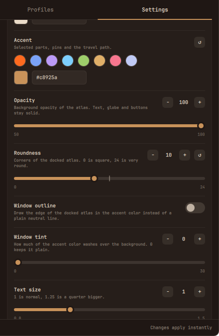
  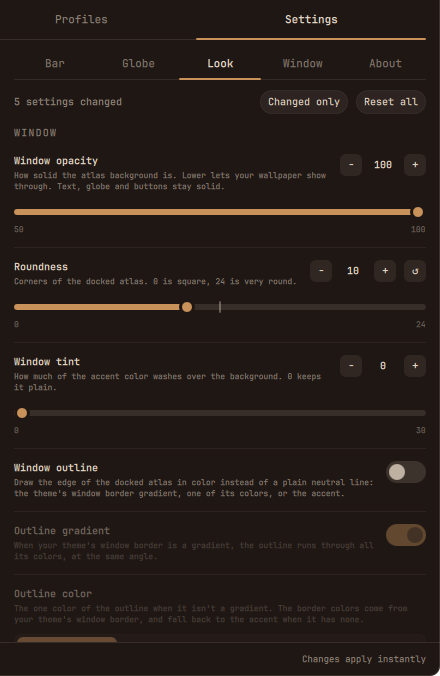
</p>

| Setting | Key | Values | Default |
| --- | --- | --- | --- |
| Atlas theme | `theme` | `auto` (follow Omarchy), `custom`, `catppuccin`, `dracula`, `everforest`, `gruvbox`, `kanagawa`, `mono`, `nord`, `omarchy`, `rose-pine`, `tokyo-night` | `auto` |
| Background | `customBg` | a hex like `#1a1b26`, custom theme only | `#1a1b26` |
| Text | `customFg` | a hex like `#c0caf5`, custom theme only | `#c0caf5` |
| Accent | `accentColor` | a hex like `#7aa2f7`, custom theme only | `#7aa2f7` |
| Window opacity | `opacity` | 50 to 100, text, globe and buttons stay solid | 100 |
| Roundness | `cornerRadius` | 0 to 24 | 12 |
| Window tint | `surfaceTint` | 0 to 30 | 0 |
| Window outline | `outline` | on / off | off |
| Outline gradient | `outlineGradient` | on / off, runs through your window border's colors at its angle | on |
| Outline color | `outlineColor` | `accent`, `first`, `middle`, `last` (of the border's colors) | `accent` |
| Text size | `fontScale` | 80 to 150 | 100 |
| Spacing | `density` | `compact`, `comfortable`, `spacious` | `comfortable` |
</details>

<details>
<summary><b>Window</b>: panel or window, size</summary>
<br>
<p align="center">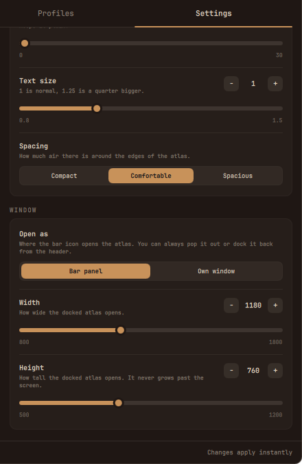</p>

| Setting | Key | Values | Default |
| --- | --- | --- | --- |
| Open as | `openAs` | `panel` (under the bar), `window` (its own window) | `panel` |
| Width | `windowWidth` | 800 to 1800, docked only (locked while popped out) | 1180 |
| Height | `windowHeight` | 500 to 1200, docked only, never taller than the screen | 760 |
</details>

<details>
<summary><b>About</b></summary>
<br>
<p align="center">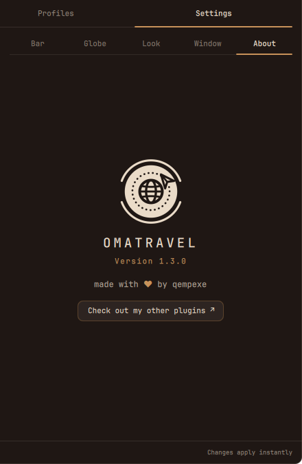</p>
</details>

## Troubleshooting

**A city has no pin.**
The lookup knows places with 1,000+ people. The city is still saved and listed,
it just doesn't know where to put it. Add `"lat"` and `"lng"` to its entry under
`city_meta` in `~/.local/share/omatravel/travel-data.json` and it shows up there.

**The globe is blank.**
It needs a working Qt shader backend. Rebuild the shaders with
`tools/build-shaders.sh` (needs `qt6-shadertools`).

**Follow Omarchy picked the wrong colors.**
If your shell tints or dims its own background, matching the theme by color can
miss, and it falls back to the shell's colors. The line under the theme settings
says what it found.

**The outline is one color, not a gradient.**
The gradient comes from your theme's active window border. A theme with a single
border color gives a single-color outline; **Outline color** picks which one.

**Where's my data?**
In `~/.local/share/omatravel/travel-data.json`, readable only by you. Exports go
to `~/.local/share/omatravel/exports/`, and only when you ask for one.

**Does it phone home?**
No. No network, no tracking. It only runs `sh` for small file jobs (folders,
saving, exporting), `cat`, `head`, `ls` and `find` to read your Omarchy theme,
`wl-paste` when you press Ctrl+V in a text field (max 1 KB), and `xdg-open` for
the link on the About tab.

**I'm coming from 1.2.**
Your settings and places carry over as they are. The new ones (globe side and the
outline's gradient and color) start at their defaults.

**Something looks off on my setup.**
I've mostly tested it on my own machines, so open an issue with a screenshot.

## Contributing

Bug reports and ideas are welcome as [issues](https://github.com/qempexe/omarchy-omatravel/issues).
For code, read [CONTRIBUTING.md](CONTRIBUTING.md) first; it has the layout, the
tests and how a change should look. Everyone taking part is expected to follow the
[code of conduct](CODE_OF_CONDUCT.md). What changed in each version is in the
[changelog](CHANGELOG.md).

### Under the hood

```
qml/
├── BarWidget.qml     the bar icon, tooltip and click actions
├── core/             TravelModel (state, saving, theme), SettingsStore
├── panel/            Panel, PanelFrame, DetachedWindow, SettingsView, SettingRow, AboutPage
├── globe/            GlobeView (shader, pins, arcs, labels)
├── controls/         FieldBox, FlatButton, SectionLabel
└── js/               Schema.js (every setting), Model.js (places, dates, stats, export),
                      GlobeProjection.js (projection and city lookup), Theme.js (window border)
shaders/              the globe shader and its compiled .qsb
assets/               the logo, and earth.png: land, borders and grid lines
data/layers/          cities by zoom level + a name lookup
tools/                scripts that rebuild the globe data and shaders
tests/                python3 tests/test_manifest.py, node tests/test_globe.js
```

The globe is a fragment shader over a land/border/grid mask, tinted with your
theme. Arcs and pins are drawn on a canvas on top with the same projection, and
the names as text on the GPU. Cities are split into four bands by population, a
band is only read from disk once you zoom in far enough to need it, and only the
places in view are ever looked at.

`assets/`, `shaders/*.qsb` and `data/layers/` come prebuilt, so installing needs
none of the tools. Those are only for rebuilding the data and are the one part
that downloads anything (Natural Earth and GeoNames). The plugin never runs them.

### Update or remove

```bash
omarchy plugin update io.github.qempexe.omatravel
omarchy restart shell        # don't skip this, the shell keeps the old version loaded
```

```bash
omarchy plugin remove io.github.qempexe.omatravel
omarchy restart shell
rm -rf ~/.local/share/omatravel ~/.local/state/omarchy-omatravel   # only if you want your map gone too
```

If the widget is still in `shell.json` after removing, delete its entry by hand.

## License and credits

The code is [MIT](LICENSE). The bundled data keeps its own terms:

- **Cities** (`data/layers/`) come from [GeoNames](https://www.geonames.org)
  `cities1000`, [CC BY 4.0](https://creativecommons.org/licenses/by/4.0/). I
  filtered them into zoom bands by population and kept only name, country code,
  population and rounded coordinates. Credit GeoNames if you reuse it.
- **Land, borders and lakes** (`assets/earth.png`) are rendered from
  [Natural Earth](https://www.naturalearthdata.com) 1:50m, public domain.
- **Flags** are emoji from your system font, nothing bundled.

Omatravel is an independent community plugin, not affiliated with or endorsed by
Omarchy or its authors.
